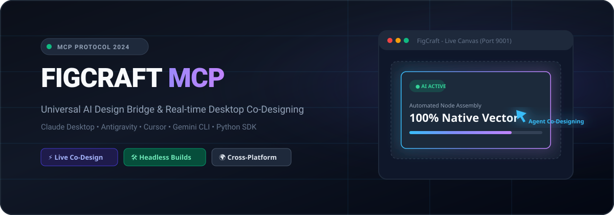

<p align="center">
  
</p>

<p align="center">
  <strong>Universal Model Context Protocol (MCP) bridge and automation toolkit for FigCraft.</strong>
</p>

<p align="center">
  <a href="https://github.com/DimNih/AGENT-MCP-FIGCRAFT/actions/workflows/ci.yml"></a>
  <a href="LICENSE"></a>
  <a href="https://www.python.org/"></a>
  <a href="https://modelcontextprotocol.io/"></a>
  <a href="https://github.com/DimNih/AGENT-MCP-FIGCRAFT/stargazers"></a>
</p>

---

## Overview

**FIGCRAFT-MCP** connects native offline vector design in **FigCraft** with AI coding agents—including **Antigravity**, **Claude Desktop**, **Cursor**, **Gemini CLI**, and custom autonomous workflows—powered by the **Model Context Protocol (MCP)**.

It allows AI agents to interact with design documents through two distinct operational modes:
1. **Interactive Live Mode:** Co-design side-by-side with your agent in a live FigCraft GUI window on port 9001.
2. **Headless Automation Mode:** Execute programmatic vector builds, layer inspections, and asset exports in background CI/CD pipelines.

---

## Architecture

```
               +---------------------------------------+
               |        AI Agent / Assistant           |
               | (Antigravity / Claude / Cursor / SDK) |
               +-------------------+-------------------+
                                   | JSON-RPC (MCP)
                                   v
                      +-------------------------+
                      |       figcraft-cli      |
                      +------------+------------+
                                   |
                  +----------------+----------------+
                  |                                 |
                  v (Mode: --attach 9001)           v (Mode: headless)
       +-----------------------+        +-----------------------+
       |     FigCraft GUI      |        | In-Memory Engine Core |
       |  (Live Canvas Draw)   |        |   (Headless Builds)   |
       +-----------------------+        +-----------------------+
```

---

## Operating Modes

### 1. Live Remote Mode (Interactive GUI)
1. Start FigCraft with remote listening enabled:
   ```bash
   # Windows (Command Prompt / PowerShell)
   start-figcraft-live.bat
   # or
   .\start-figcraft-live.ps1

   # macOS / Linux
   ./scripts/start-figcraft-live.sh

   # Or using Python CLI:
   python -m figcraft_mcp live
   ```
2. Place the FigCraft window side-by-side with your AI chat window.
3. Instruct your AI agent to design or modify components. Changes appear immediately on canvas.

### 2. Headless Mode (Background & CI/CD)
Execute node manipulations, inspect layer hierarchies, and export files directly through `figcraft-cli` without a graphical window.

---

## Quickstart

### 1. Clone & Verify
```bash
git clone https://github.com/DimNih/AGENT-MCP-FIGCRAFT.git
cd AGENT-MCP-FIGCRAFT

# Run automated system diagnostics
python test-connection.py
```

### 2. Generate Client Configuration
Generate the configuration matching your operating system and paths:
```bash
python -m figcraft_mcp setup
```
To write it directly to a file:
```bash
python -m figcraft_mcp setup -w mcp_config.json
```

---

## Client Integration

### Claude Desktop
Add the following to your `claude_desktop_config.json`:
- **Windows:** `%APPDATA%\Claude\claude_desktop_config.json`
- **macOS:** `~/Library/Application Support/Claude/claude_desktop_config.json`

```json
{
  "mcpServers": {
    "figcraft-live": {
      "command": "figcraft-cli",
      "args": ["mcp", "--attach", "9001"]
    }
  }
}
```

### Antigravity & Cursor
Copy the configuration output from `python -m figcraft_mcp setup` into your workspace MCP settings.

---

## Python SDK Example

```python
from figcraft_mcp import FigCraftClient

# Connect to the live desktop session
with FigCraftClient(mode="live", port=9001) as client:
    # 1. Create main container
    card_id = client.create_frame(
        name="Auth Card",
        x=60,
        y=48,
        width=360,
        height=200,
        props={"cornerRadius": 8, "fills": [{"type": "solid", "color": "#171C25"}]}
    )

    # 2. Add text layer
    client.create_text(
        text="Access Gateway",
        name="Header",
        x=24,
        y=28,
        parent=card_id,
        props={"fontSize": 16, "fills": [{"type": "solid", "color": "#F0F3F6"}]}
    )

    # 3. Add primary button
    client.create_rect(
        name="Button",
        x=24,
        y=120,
        width=120,
        height=36,
        parent=card_id,
        props={"cornerRadius": 4, "fills": [{"type": "solid", "color": "#E25624"}]}
    )
```

Run the built-in interactive demo:
```bash
python -m figcraft_mcp demo
```

---

## Environment Variables

| Variable | Description |
| :--- | :--- |
| `FIGCRAFT_CLI_PATH` | Explicit path to `figcraft-cli` executable. |
| `FIGCRAFT_PATH` | Explicit path to `figcraft` GUI executable. |
| `FIGCRAFT_AUTOMATION_ROOT` | Custom root directory for headless operations (default: user home). |

---

## Contributing

Contributions and bug reports are welcome. Please refer to [CONTRIBUTING.md](CONTRIBUTING.md) for details.

---

## License

Distributed under the [MIT License](LICENSE).
